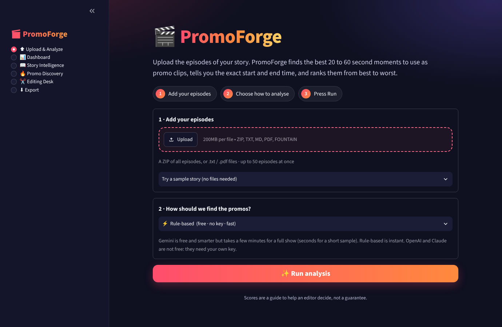
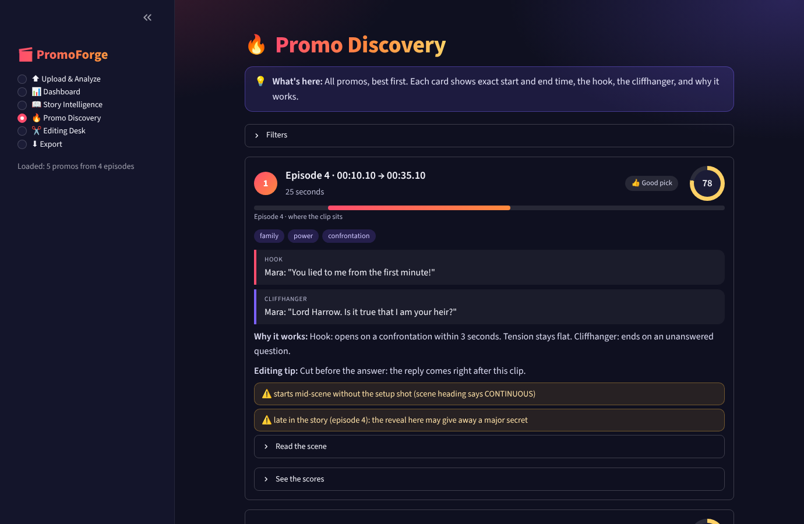

# 🎬 PromoForge

**Upload the episodes of a story. PromoForge finds the best 20 to 60 second moments to use as promo clips, tells you the exact start and end time, and ranks them from best to worst.**

> ### 👉 Try it live: **https://YOUR-APP-NAME.streamlit.app**
> *(Replace the address above with your own link after you deploy. Steps are in [DEPLOY.md](DEPLOY.md). No install, no login, no API key needed to open it.)*

<p align="center">
  
  
</p>

## How to use it (no technical knowledge needed)

1. **Add your episodes.** Drop a ZIP of all episodes, or many `.txt` / `.pdf` files (up to 50 at once). No files? Pick a sample story.
2. **Choose how to analyse.** *Rule-based* is free and instant. *Gemini* is free and smarter, but takes a few minutes for a full show.
3. **Press Run analysis.** You land on a Dashboard with the best picks. Open **Promo Discovery** to see every promo as a card: exact
   times, the hook, the cliffhanger, why it works, and a warning if it may confuse a new viewer. Press **Keep** or **Skip**,
   then download everything from **Export**.

Every page starts with a short "What's here" line, so nobody has to guess.

| Choice | Cost | Speed | Notes |
|---|---|---|---|
| **Rule-based** | free, no key | seconds | Written rules look for hooks and cliffhangers. Always works. |
| **Gemini** | free (Google AI Studio free tier) | a few minutes for 50 episodes | An AI reads each candidate like a viewer. The hosted app has the key stored privately, so visitors type nothing. If the free daily limit is used up, the app says so and shows how to make your own free key. |
| **OpenAI**, **Claude** | **not free** | a few minutes for 50 episodes | A pop-up asks for your own key. If you have none, pick Rule-based or Gemini. |

## What is under the hood

**Hybrid by design.** Python reads the script, lists every valid clip window, scores ten things an editor checks (hook, cliffhanger, flow, clear without context, emotion, curiosity, rising tension, appeal, spoiler control, length), ranks the results and checks every
timestamp. The AI is optional: it judges short candidate clips, and it **never decides timestamps**. It sees and returns *beat IDs*
(`E021-S02-B003`). Python converts them to times and re-validates, so a model cannot invent a time or a quote.

**Honesty rules**

* The scores are a guide, not a guarantee. The ten weights (hook .15, cliffhanger .15, flow .12, clear-alone .11, emotion .10,
  appeal .10, rising tension .09, curiosity .08, spoiler control .05, length .05) are editorial assumptions, not validated against
  real editor decisions.
* Quality over count: a promo is listed only if it clears a quality floor, so the list can be long (up to 60) but never padded.
* No invented accuracy numbers. Precision can only come from real human labels (the Keep / Skip choices on the Editing Desk page); otherwise the
  `evaluate` command prints `NOT CALCULABLE (no labels)`.
* The AI path is tested with a fake AI and a fake web server. Real-model behaviour depends on your own run.
* Text only (no audio or video) and English-first cue lists. The tool warns when timing had to be estimated.
* This repository contains **no** confidential show material. `sample_data/` holds stories invented for testing.

## Run it on your laptop

1. Install Python 3.10 or newer from python.org (Windows: tick **Add Python to PATH**).
2. Open a terminal **inside this folder** (Windows: click the folder's address bar, type `cmd`, press Enter).
3. Install and start (Windows PowerShell or cmd; no activation step needed):
   ```
   python -m venv .venv
   .venv\Scripts\python -m pip install -r requirements.txt
   .venv\Scripts\python -m streamlit run app.py
   ```
   Mac: `python3 -m venv .venv`, then `.venv/bin/python -m pip install -r requirements.txt`, then `.venv/bin/python -m streamlit run app.py`.
4. Your browser opens the app. Optional AI key for your own laptop: copy `.env.example` to `.env` and paste a free key from
   https://aistudio.google.com/apikey after `PROMOFORGE_API_KEY=`. Never commit `.env` and never paste a key into a chat.

## Command line (for developers)

| Command | What it does |
|---|---|
| `python -m promoforge run --input X --out Y [--provider gemini] [--rules-only]` | Analyse a ZIP / folder / `.txt` / `.md` / `.pdf` and save JSON and CSV |
| `python -m promoforge evaluate --run Y --reviews reviews.json` | Honest metrics from real Keep / Skip labels |
| `python -m promoforge doctor` | Plain-words setup check (works before `pip install`) |
| `python -m pytest -q` | 100+ tests (`pip install -r requirements-dev.txt` first) |

Outputs per run: `promos.json`, `promos.csv`, `run_report.json`, `story_intelligence.json`, `review_sheet.csv`, `parsed_script.json`, `promo_texts/` (one .txt per promo) and `promo_texts.zip`,
`missed_candidates.json`, `failure_analysis_private.md` (with quotes) and `failure_analysis_public_redacted.md` (no quotes or names).

## Change the wording, colours or AI list

Everything a non-developer may want to change is in **one file: [`ui_config.py`](ui_config.py)**: the name and tagline, the "What's here"
line of each page, the colours, the AI list (free or not free, where to get a key) and the hidden settings (promo count, AI call budget).

## Input formats (auto-detected per file, nothing hard-coded to one story)

| Format | Looks like | Timing |
|---|---|---|
| labelled blocks | `**SPEAKER (emotion):**` then `Start: (mm:ss.xx) \| End: (mm:ss.xx)` then text | from the file |
| inline | `[mm:ss - mm:ss] NAME: text` | from the file |
| Fountain / INT.-EXT. | slug lines, CHARACTER cues, dialogue | **estimated** from word counts and flagged |
| prose | plain paragraphs | **estimated** and flagged |
| PDF | text extracted, blank lines lost | parsed in "compact mode" with a warning |

## Layout

```
app.py                 the web app (6 pages)          ui_config.py   wording, colours, AI list, hidden settings
ui_logic.py            which AI + which key + pop-up reasons (no Streamlit import, easy to test)
promoforge/            parser, ingestion, validator, candidate_generator, scoring, ranking, story_engine,
                       llm_judge, llm_provider, pipeline, evaluation, cli, doctor
tests/                 pytest suite              sample_data/   invented stories (3 formats)
tools/                 sample generator, generalization test, PDF builder, confidentiality scanner
docs/                  architecture, methodology, generalization test, video script, screenshots
DEPLOY.md              GitHub + live link, step by step for a beginner
```

See `docs/methodology.md` and `docs/architecture.md` for how scoring and the AI step work.
